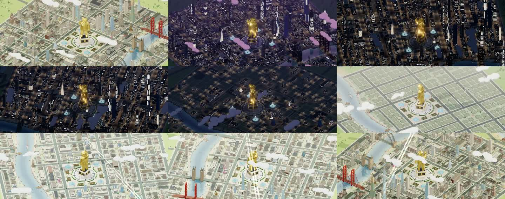

# Teardown 2: Fomopoly (fomopoly.com)

**Checked:** 2026-10-22
**Sources:**
- [fomopoly.com](https://fomopoly.com): the full HTML and `js/app.js` (13 KB), read in full.
- The cover video (`assets/cover-960.mp4`): I pulled frames from it.
- [@fomopoly_rh on X](https://x.com/fomopoly_rh): all 7 posts and the video thumbnails.
- KuCoin Square campaign posts ([1](https://www.kucoin.com/square/post/content_6ad9c1904bae8c0007c19b5b), [2](https://www.kucoin.com/square/post/content_6ad81ac19dbd9d000711b776)), part of a RareList campaign.

**Status:** **pre-launch.** The site is only a whitelist funnel, and there are no docs, contracts or game client yet.
**Chain:** Robinhood Chain. **Token:** $DEAL.
**Bio:** "A super-Ponzi game built on FOMO and $DEAL."

> **Honesty note:** the game's rules aren't public yet. Section 1 lists **confirmed** facts. Section 3 gives my **reading of the genre** from their own words, marked as inference.

---

## 1. Confirmed facts
| Item | Source |
|---|---|
| "Land plots are at the core of Fomopoly. **Lands drive the game and produce $DEAL.**" | Site copy |
| Plots "will normally cost **ETH**", but whitelisted users can **mint free** | Site copy ("Mint price: Free · Launch date: TBA · Chain: Robinhood") |
| "**Every land plot generates $DEAL & stocks.**" | X post, Oct 9 |
| "The most FOMOmaxxed onchain Ponzi on Robinhood. **Buy & sell land plots, earn stocks, farm $DEAL. If you're first and you're fast, you win.**" | X post, Oct 19 |
| "This city is built for FOMO. Enter accordingly." / "First came the land plots. Then came the deals." / "The lights turn on, the city wakes up. And then the FOMOniacal part begins." | X posts, Oct 1–7 |
| About 6.9k followers, and 25–54k views per video post | X |
| A RareList campaign: a $2k pool, 50 free mints, a $DEAL airdrop | KuCoin posts |

## 2. The whitelist funnel (what the site actually does)
The `app.js` code runs a 3-step application:
1. **Enter your X handle.**
2. **Post about Fomopoly:**
   - The site generates a draft: "Going for a spot on the @… whitelist for a free mint! The biggest ponzi game is loading. #<code>".
   - **The code is unique to you.** You paste your post's URL, and they review it **by hand**.
3. **Submit an EVM wallet.** Then: "We'll manually review your account and post. Keep your DMs open on X!"

**What it achieves:** cheap virality (every applicant posts), sybil filtering (a hand review), and a "free mint" that sets an anchor price, since land "normally costs ETH".

## 3. Visual design (from the video frames)
- **A 3D isometric city diorama:**
  - A grid of city blocks split into many **plots**.
  - A river with bridges (a Golden Gate look-alike and a Tower Bridge look-alike), a lighthouse, a coastline, and parks.
- **A giant golden statue in the central plaza**, with fountains around it. It's the visual anchor, a "tycoon" figure.
- **Time-lapse:**
  - Empty plots (beige lots) **fill with buildings**: houses, then mid-rises, then skyscrapers.
  - The city goes from day to night, with lit windows and neon clouds.
  - Beams of light rise from plots, probably marking purchases.
- **The message:** *the city grows as people buy in, and the lights come on.*

## 4. Reading the genre (inference, not confirmed)
"Super-Ponzi", "first and fast wins" and "buy & sell land plots that farm a token" put Fomopoly in a well-known lineage:

| Ancestor | Mechanic Fomopoly probably borrows |
|---|---|
| **Fomo3D (2018)** | Every buy raises the key price and extends a countdown. The **last buyer before the timer ends wins the pot**. Holders earn dividends from later buyers |
| **Land and plot "miners"** (e.g. Bitcoin Miner / Hamster-style idle games, Crypto Kingdoms) | A plot **emits a token at a rate**. Upgrades raise the rate. Prices step up as supply sells out |
| **Monopoly** (the name, the city) | Plots in a city, trading, rents |

So the likely loop is:
1. Mint or buy a plot. **Early plots are cheaper** ("first and you're fast").
2. The plot farms $DEAL and earns "stocks", which on Robinhood Chain probably means **tokenized stock** rewards or in-game shares.
3. Later buyers pay more. Sell plots to them.
4. Late entrants fund early ones. That's the "Ponzi" they joke about openly.

## 5. What they get right
1. **FOMO as a design pillar, said openly.** Escalating entry costs plus a first-mover advantage make early action urgent.
2. **Land is the asset.** Each plot is an NFT with a yield. Anyone gets "I own a piece of the city" at once.
3. **A city that visibly grows** from buying. Seeing the city fill up is the retention hook and a marketing video in one.
4. **A central tycoon statue:** one figure to aspire to.
5. **A distribution engine:** a free mint in exchange for X posts with a unique code.

## 6. Risks and weaknesses
- **"Ponzi" economics:** if the yield is emitted $DEAL, the token inflates and the price bleeds. Late entrants lose. They can say "Ponzi" openly; a Chogathon entry can't.
- **Plots are the NFT,** a new collection. They don't use an existing community's NFT.
- **No game rules are public.** The hype is all video.

---

## 7. What to take for Chogopoly
| Steal | How it shows up in Chogopoly (and where we're safer) |
|---|---|
| **Escalating land prices, first and fast** | **Property shares ("Bricks") sit on a bonding curve.** Every buy raises the price, so early Chogs win. **You can only buy where your Chog is standing**, which rate-limits whales and makes the dice matter |
| **Plots produce yield** | Properties earn **rent paid by other Chogs** in $CHOG. That's **real flow, not emissions**: nothing is minted |
| **The Fomo3D last-buyer timer** | **The Closing Bell:** in the last 24 h of each season, every Brick buy adds 60 s to a timer. When it hits zero, **the last buyer's Chog wins 10% of the season pot** |
| **The golden tycoon statue** | **The Golden Chog:** the season's #1 Chog by empire value is rendered as a **gold statue in the centre of the board** all next season, and earns 1% of all rent |
| **A city that grows with the money in it** | Each property's building grows with its curve reserve: **lot → cottage → shop → tower → neon skyscraper**. Plus day and night |
| **Free mint for posts** | **"Founder" starter cash:** the first 500 Chogs to wake up and post with a code get a small starter pack from the launch treasury |
| **Their weakness: inflation** | We **never mint**, and burns are built in. $CHOG gets buy pressure from dapp squares (see the plan) |
